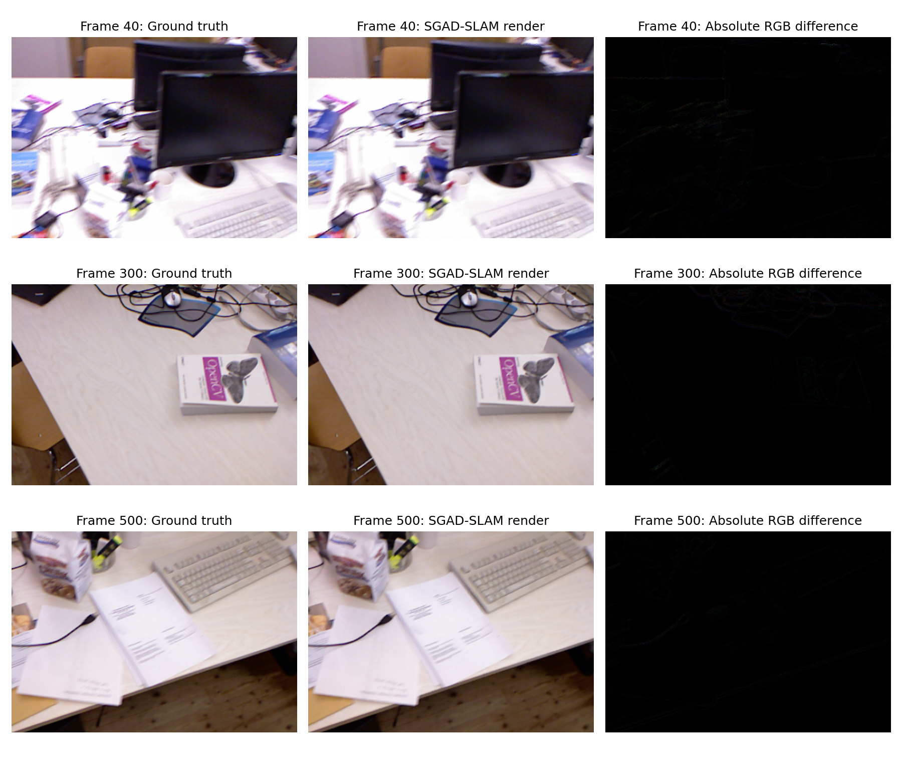

# SGAD-SLAM 复现记录

这是对 [Hu 与 Han，*SGAD-SLAM: Splatting Gaussians at Adjusted Depth for Better Radiance Fields in RGBD SLAM*](https://arxiv.org/html/2603.21055v1) 的**个人复现记录**。算法和原始实现来自作者的 [SGAD-SLAM 仓库](https://github.com/MachinePerceptionLab/SGAD-SLAM)。本仓库保存本机实验的命令、兼容性修改、指标与小型可视化产物，不重新发布作者的完整源码。

目前完成了 TUM RGB-D `rgbd_dataset_freiburg1_desk` **592 个关联帧**的一次完整端到端运行，以及跟踪关键帧间隔的诊断。尚未复现论文的全部场景、多次运行平均和重建指标。

## 结果一览

| 运行 | 跟踪关键帧间隔 | 代码显示 ATE¹ (cm) | 真正 RMSE² (cm) | PSNR (dB) | SSIM | LPIPS |
| --- | ---: | ---: | ---: | ---: | ---: | ---: |
| 作者 TUM 脚本参数 | 16 | 50.13 | 59.14 | 39.2111 | 0.997703 | 0.009186 |
| 诊断参数 | 8 | 2.88 | 3.86 | 39.2114 | 0.997703 | 0.009186 |
| 论文报告的 fr1/desk | — | 2.2 | — | 39.21 | 0.998 | 0.009 |

¹ 作者代码打印“ATE-RMSE”，实际计算的是对齐后每帧平移误差的**算术平均值**。² 对同一批误差另行计算的均方根；不能直接断定论文的 2.2 cm 与哪一种代码口径完全相同。渲染指标是在输入序列视角上计算，不代表新视角合成质量。默认参数的跟踪在中后段发生明显漂移，渲染指标因此不能单独证明 SLAM 全局轨迹正确。

下图和视频来自**间隔 8** 的诊断运行：



[观看渲染抽帧视频](results/tum_fr1_desk/rendered_sample.mp4) · [默认参数轨迹](results/tum_fr1_desk/trajectory_default.png) · [间隔 8 的轨迹](results/tum_fr1_desk/trajectory_kfreq8.png)

视频包含每 5 帧保存一张的 119 张渲染图，10 FPS；它是可视化预览，并非实时系统录屏或新视角漫游。

## 仓库内容

```text
README.md                         结果与范围
docs/reproduction.md              环境、数据、命令、实验过程与限制
docs/code-guide.md                论文概念与作者代码的对应关系
configs/tum_fr1_desk_kfreq8.yaml  诊断运行的建图输出配置
patches/runtime_compat.patch      本机内存、构建和评测读取兼容性改动
scripts/                         环境/GPU 检查、跟踪诊断、结果预览
results/tum_fr1_desk/             两组 JSON 指标、轨迹图、对比图和短视频
```

请从[复现步骤](docs/reproduction.md)开始。完整 TUM 数据、环境、日志、逐帧渲染图和约 16 GB/场景的高斯子地图保存在本机，不纳入 Git。原始数据应从数据集官方来源取得；作者源码应从作者仓库取得。
