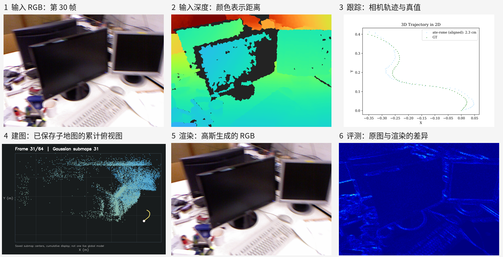

# TUM fr1/desk 64 帧演示

从官方完整序列的 RGB 和深度列表各取前 80 条，时间关联后得到 64 帧。跟踪、逐帧建图、渲染和评测均已完成。代码显示的 ATE 为 2.30 cm（平移误差算术平均值）；真正 RMSE 为 2.53 cm。64 帧输入视角重渲染的平均 PSNR 为 38.8913 dB，SSIM 为 0.997643，LPIPS 为 0.010332。



[逐帧建图视频](map_growth.mp4) · [渲染抽帧视频](rendered_sample.mp4) · [轨迹图](trajectory.png) · [原始指标 JSON](rendering_metrics.json)

建图视频是运行结束后从 64 个子地图检查点抽取高斯中心生成的累计俯视图，展示地图如何随输入帧增加；系统本身在这一配置中每帧保存独立子地图。渲染视频从已保存的 13 张渲染图组成，并非实时录屏或新视角漫游。

## 重新运行

在已经准备好作者源码、依赖和完整 TUM fr1/desk 数据后，先激活安装好依赖的 `paper_a` 环境，再执行：

```bash
python3 /path/to/Hu_SGDA/scripts/make_tum_subset.py \
  /path/to/SGAD-SLAM/dataset/TUM/rgbd_dataset_freiburg1_desk \
  /path/to/SGAD-SLAM/dataset/TUM/rgbd_dataset_freiburg1_desk_first80
/path/to/Hu_SGDA/demos/tum-desk-64/run.sh \
  /path/to/SGAD-SLAM /path/to/new-output-directory
```

`run.sh` 使用当前激活的 Python 环境，输出必须是新路径。它会在输出目录生成建图配置和日志；每帧子地图检查点可能占数 GB，因此这里仅上传紧凑预览。完整环境与源码准备见[复现步骤](../../docs/reproduction.md)。
